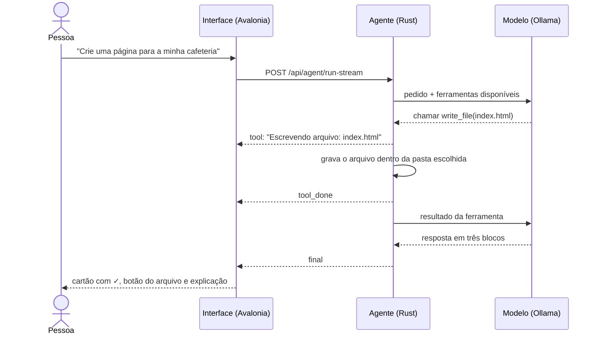

# A11y Agent

Um agente de IA que trabalha no seu computador e **explica o que fez**, para quem nunca abriu um terminal.

---

## Uma conversa de verdade

Esta é uma execução real, gravada em 2 de novembro de 2026 com o modelo `qwen2.5:7b` rodando só na CPU (levou 5 minutos). O texto abaixo não foi editado.

> **Pedido**
>
> Crie uma página simples e acessível para a minha cafeteria, a Café da Praça. Ela abre das 7h às 18h.

> **O que a pessoa vê enquanto o agente trabalha**
>
> Lendo seu pedido e decidindo o que fazer…> ✓ Escrevendo arquivo: index.html> Pensando no próximo passo…

> **Resposta final**
>
> **O que eu fiz:**> Criei um arquivo `index.html` no diretório raiz do seu projeto. Esse arquivo contém um código HTML simples e acessível para a sua cafeteria, Café da Praça, com informações sobre o horário de funcionamento.
>
> **Como usar ou conferir:**
> 1. Abra o arquivo `index.html` em um navegador web.
> 2. Verifique se o título da página é "Café da Praça".
> 3. Confira se o horário de funcionamento está corretamente exibido como "7h às 18h".
> 4. Teste a legibilidade da página, especialmente para pessoas com deficiência visual, para garantir que ela seja acessível.
>
> **Próximo passo sugerido:**> Agora que a página básica foi criada, você pode adicionar mais informações, como menu, localização, ou imagens da cafeteria. Quer adicionar mais detalhes ou ajustar o design?

O arquivo criado já vem com `lang="pt-BR"`, `<title>` e modo escuro. Mesmo assim, a resposta ainda escorrega: "diretório raiz" é jargão que a pessoa não precisava ler. Melhorar isso é parte do trabalho deste projeto.

---

## O mesmo momento, em duas telas

Quando o agente grava o arquivo, o servidor envia este evento:

```json
{"kind":"tool","message":"Escrevendo arquivo: index.html","tool":"write_file","refresh_tree":true,"path":"index.html"}
```

| O que o sistema produz por dentro                              | O que a pessoa vê                                         |
| -------------------------------------------------------------- | --------------------------------------------------------- |
| `"tool":"write_file"`, `"path":"index.html"`                   | ✓ Escrevendo arquivo: index.html                          |
| `falha ao enviar requisição ao LLM`                            | Não consegui falar com o modelo de IA (Ollama). Abra o programa Ollama e tente de novo. |
| `limite de repetições atingido (3); interrompendo o laço`      | Fiquei repetindo a mesma ação sem avançar. Tente pedir de forma mais específica, por exemplo dizendo o nome do arquivo. |
| `limite de passos atingido (16) sem resposta final`            | O pedido era grande demais para uma vez só. Tente dividir em partes menores. |

As mensagens da esquerda estão no código, exatamente assim. A informação é a mesma; o que muda é quem consegue entendê-la. O projeto inteiro gira em torno dessa tradução.

---

## Em leitura fácil

Este programa ajuda você a criar arquivos no computador.

Você escreve o que quer, com as suas palavras.

O programa faz o trabalho e mostra cada passo.

No fim, ele explica o que fez e como conferir.

Ele só mexe na pasta que você escolher.

Tudo fica no seu computador. Nada vai para a internet.

---


---

## Cinco regras que o código segue

Cada regra aponta para o lugar do código onde ela está implementada, para você conferir.

1. **Ninguém lê nome de ferramenta.** Toda ação vira uma frase. Exemplo: `str_replace` aparece como "Editando arquivo: …".
   Código: `friendly_tool_message` em [`src/agent/progress.rs`](src/agent/progress.rs).

2. **Todo passo tem um fim visível.** Cada ação começa com "…" e termina com ✓ ou ⚠. Nenhuma fica pendurada.
   Código: os eventos `tool`, `tool_done` e `tool_failed` em [`progress.rs`](src/agent/progress.rs), e `ChatMessage.FinishLastStep` em [`desktop/Models/ChatMessage.cs`](desktop/Models/ChatMessage.cs).

3. **A resposta final ensina a conferir.** O modelo é instruído a sempre responder com *o que eu fiz*, *como usar ou conferir* e *próximo passo*.
   Código: prompt de sistema em [`src/agent/loop.rs`](src/agent/loop.rs).

4. **Erro é instrução, não desabafo.** Mensagens técnicas viram uma ação que a pessoa consegue fazer. O detalhe técnico fica recolhido, para quem quiser ajudar.
   Código: `FriendlyError` em [`desktop/ViewModels/MainViewModel.cs`](desktop/ViewModels/MainViewModel.cs).

5. **O leitor de tela ouve o mesmo que os olhos veem.** O status é uma *live region*, cada mensagem tem nome acessível e cada ✓ é falado como "Concluído: …".
   Código: `AutomationProperties` em [`desktop/Views/MainWindow.axaml`](desktop/Views/MainWindow.axaml).

---

## Começar a usar

Você precisa de duas coisas: o **[Ollama](https://ollama.com/download)** (o programa que roda a IA no seu computador) e o modelo, baixado uma vez:

```bat
ollama pull qwen2.5:7b
```

Depois:

1. Abra o Ollama e depois o **A11y Agent**.
2. Clique em **Escolher pasta**.
3. Escreva o pedido e aperte **Enter**.
4. Em menos de um minuto aparece **Meu plano**, com as etapas. Se estiver bom, clique em **Começar**. Se o pedido for ambíguo, o assistente pergunta antes ("janela no computador ou página web?") e você responde com um clique.
5. Acompanhe: cada etapa vai de ○ para … e depois para ✓, e o cartão mostra há quanto tempo o assistente está trabalhando.

No topo, em **Modelo**, você escolhe qualquer modelo instalado no Ollama. Modelos menores respondem mais rápido. Para instalar outro, digite no terminal `ollama pull nome-do-modelo` e clique em ⟳.

Sem placa de vídeo, um pedido de três etapas leva uns 5 minutos com o `qwen2.5:7b`. **Cancelar** (ou `Esc`) para o trabalho na hora, e o Ollama deixa de usar a CPU. Ao fechar o app, o modelo também sai da memória.

| Tecla           | O que faz                       |
| --------------- | ------------------------------- |
| `Enter`         | Envia o pedido                  |
| `Shift + Enter` | Pula linha                      |
| `Ctrl + O`      | Escolhe ou troca a pasta        |
| `Esc`           | Cancela                         |
| Setas           | Passam de uma mensagem para outra na conversa |

<details>
<summary><strong>Primeira instalação (para quem vai configurar o computador)</strong></summary>

Com [Rust](https://rustup.rs/) e o [.NET SDK 10+](https://dotnet.microsoft.com/download) instalados, rode uma vez:

```bat
iniciar.bat
```

O script compila o agente, publica a interface em `app\`, cria o atalho **A11y Agent** na Área de Trabalho e abre o app. Depois disso, o script não é mais necessário. Para gerar de novo, use `iniciar.bat rebuild`.

</details>

<details>
<summary><strong>Quando algo não funciona</strong></summary>

| O que aparece                       | O que fazer                                                        |
| ----------------------------------- | ------------------------------------------------------------------ |
| Selo **Desligado**                  | Abra o Ollama e clique em **Tentar ligar de novo**                  |
| "O modelo de IA não está instalado" | `ollama pull qwen2.5:7b`                                            |
| "Fiquei repetindo a mesma ação"     | Peça de novo dizendo o nome do arquivo                              |
| `Acesso negado` ao recompilar       | Feche o app e o processo `rust-a11y-agent.exe`                      |

</details>

---

## O que ainda não está bom

Este projeto quer servir de referência em acessibilidade, então os limites ficam à vista:

- **A API local não tem proteção.** Ela responde a qualquer página aberta no navegador (CORS aberto, sem token). Feche o app quando não estiver usando.
- **No app, o assistente não roda comandos no terminal.** Ele cria e edita arquivos, e a explicação final diz como abrir o resultado. Nos modos `chat` e MCP o `run_terminal` continua disponível e **não tem isolamento real**: o comando começa na pasta, mas pode alcançar o resto do sistema.
- **O contorno de foco tem contraste 2:1**, abaixo do mínimo de 3:1 (WCAG 1.4.11).
- **Ainda não houve teste com NVDA, Narrador nem com pessoas usuárias.** Tudo acima é intenção de projeto, não resultado medido. A única exceção são os contrastes de texto (14,6:1, 6,3:1 e 6,1:1), que foram medidos.
- **Modelos pequenos erram e usam jargão**, como o "diretório raiz" da conversa lá em cima.

Se você usa leitor de tela, tem deficiência cognitiva ou trabalha com quem tem, o seu relato vale mais que qualquer código. Abra uma *issue* contando o que aconteceu, sem precisar saber programar.

---

## Por dentro



A mesma caixa de ferramentas também está disponível via **MCP** (Model Context Protocol). Assim, Claude Desktop, Cursor e outros clientes podem usar `simplificar_texto` e `verificar_compreensao`.

<details>
<summary><strong>Compilar, testar e estrutura do código</strong></summary>

```bat
cargo build --release
cargo test
cd desktop && dotnet run
```

```text
src/
  api/          API HTTP (Axum) e eventos ao vivo (SSE) para a interface
  agent/        laço do agente, ferramentas, pasta permitida, mensagens amigáveis
  llm/          cliente compatível com a API da OpenAI (Ollama por padrão)
  mcp_server/   servidor MCP via stdio e HTTP
desktop/
  Models/       ChatMessage e ChatStep (um cartão, seus passos e seus arquivos)
  Services/     AgentHost (liga e desliga o agente) e AgentApiClient (HTTP + SSE)
  ViewModels/   estado da tela
  Views/        layout e acessibilidade (AutomationProperties)
```

**Comandos do agente**

| Comando                                   | Para quê                           |
| ----------------------------------------- | ---------------------------------- |
| `serve-api --bind 127.0.0.1:8787`         | API usada pela interface           |
| `chat --task "..." --workspace .`         | agente no terminal, com aprovação do plano |
| `mcp-server`                              | MCP via stdio                      |
| `mcp-http --bind 127.0.0.1:8000`          | MCP via HTTP                       |

**Configuração**

| Variável         | Padrão                      |
| ---------------- | --------------------------- |
| `LLM_PROVIDER`   | `ollama` (também `openai`, `nvidia`) |
| `LLM_MODEL`      | `qwen2.5:7b`                |
| `LLM_BASE_URL`   | `http://127.0.0.1:11434/v1` |
| `LLM_API_KEY`    | `ollama`                    |
| `A11Y_WORKSPACE` | pasta atual (modos MCP e `chat`) |
| `A11Y_AGENT_EXE` | busca automática do binário |

</details>

<details>
<summary><strong>Eventos ao vivo e ferramentas</strong></summary>

**Eventos** (`POST /api/agent/run-stream`, `event: progress`)

| `kind`        | Significa                   | Na tela                     |
| ------------- | --------------------------- | --------------------------- |
| `status`      | O agente está pensando      | Atividade atual, em itálico |
| `step_start`  | Uma etapa do plano começou  | A etapa vai de ○ para …     |
| `step_done`   | A etapa terminou            | A etapa vira ✓              |
| `tool`        | Uma ação começou            | Passo "…"                   |
| `tool_done`   | A ação deu certo            | O passo vira ✓              |
| `tool_failed` | A ação falhou               | O passo vira ⚠, com o motivo |
| `final`       | Resposta em três blocos     | Texto do cartão             |
| `error`       | O pedido inteiro falhou     | Cartão de erro              |

**Ferramentas de acessibilidade cognitiva:** `simplificar_texto`, `verificar_compreensao`, `criar_lembrete`.

**Ferramentas de arquivo:** `read_file`, `write_file`, `str_replace`, `list_dir`, `mkdir`, `delete_path`, `glob_files`, `grep_search`, `create_structure` e `run_terminal` (este só nos modos `chat` e MCP).

**Plano:** `POST /api/agent/plan` com `{"task": "...", "model": "..."}` devolve `{"passos": [...]}` ou `{"pergunta": "...", "opcoes": [...]}`. As etapas aprovadas vão em `steps` no `run-stream`. `GET /api/models` lista os modelos do Ollama.

**Como adicionar uma ferramenta:** defina os argumentos em `src/agent/tools.rs` ou `fs_tools.rs`, registre em `openai_tool_definitions()` e no MCP (`src/mcp_server/handler.rs`). Depois escreva a frase que a pessoa vai ler em `progress.rs`, leia em voz alta e reescreva até soar natural.

</details>

---

## Licença

[MIT](./LICENSE). Criado e mantido por **Josias** ([@JosiasAz](https://github.com/JosiasAz)).
